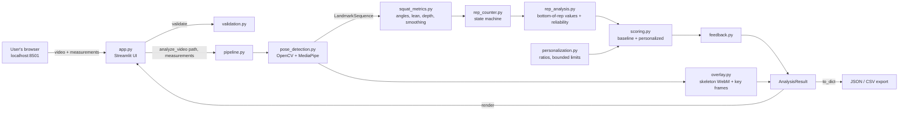

# Architecture

## The simplest working architecture

One Python process, no database, and no network services. Streamlit serves the UI,
and the analysis is a plain Python package that the UI calls. This matches the poster
methodology (Python + Streamlit + MediaPipe + OpenCV + NumPy) and the requirement to
run locally without subscriptions, API keys, or a GPU.



The same chain as text, for slides:

```
video ──► OpenCV frames ──► MediaPipe Pose ──► 33 landmarks/frame
      ──► angles per frame ──► smoothing ──► rep state machine
      ──► measurements at each rep's lowest point ──► score (10 − deductions)
      ──► baseline vs. personalized ──► feedback + charts + overlay
```

## How the frontend talks to the analysis

`app.py` never computes an angle. It does three things:

1. Collects input with Streamlit widgets and validates it through
   `ratemyform.validation`. The same checks run in the CLI scripts and the tests.
2. Saves the upload to a temporary folder and calls **one function**:
   `analyze_video(path, measurements, config, progress=callback)`.
3. Renders the returned `AnalysisResult` (scores, tables, charts, overlay, and JSON
   export).

Streamlit re-runs `app.py` from top to bottom on every click. The current stage and
the finished result are kept in `st.session_state`, so they survive those reruns. A
progress callback passed into the pipeline drives the progress bar.

## Module responsibilities

| Module | Responsibility | Team area (Status Report 2) |
|---|---|---|
| `app.py` | Three-stage UI, input widgets, results rendering | Eric (UI/upload), Tracy (screens, workflow, integration) |
| `pose_detection.py` | Read and downscale frames; run PoseLandmarker in VIDEO mode; landmarks to arrays | Tristan, Kyle |
| `overlay.py` | Draw the skeleton, HUD, WebM overlay, and rep key frames | Kyle (overlay) |
| `squat_metrics.py` | Pick a side, facing direction, orientation check; per-frame metrics; smoothing; video ratio estimates | Kyle |
| `rep_counter.py` | Hysteresis state machine; partial, incomplete, and too-fast movements | Kyle |
| `rep_analysis.py` | Bottom-of-rep values and per-metric reliability | Kyle / Tracy |
| `personalization.py` | Ratios, bounded torso-lean adjustment, entered-vs-video checks | Team (poster) |
| `scoring.py`, `feedback.py` | Deductions, explanations, tips | Billy (guidelines), Tracy |
| `config.py` | Every threshold in one place, with provenance tags | Billy (values), all |
| `validation.py` | Input safety | Tracy (requirements) |
| `synthetic.py` | Ground-truth test data (SYNTHETIC) | Testing |
| `pipeline.py` | Orchestrates everything; JSON schema | Tracy (integration) |

## Key data structures

- `LandmarkSequence` (`landmarks.py`): NumPy arrays for a whole video, holding
  timestamps, a detected flag, pixel `image_xy` (N×33×2), `visibility` (N×33), and
  `world_xyz` (N×33×3). Video and synthetic data share this structure, which is why
  the logic can be tested without video.
- `FrameMetrics`: raw, smoothed, valid, and interpolated series for each metric.
- `RepWindow` → `RepMeasurements` → `RepScore` → `AnalysisResult`.

See [DATA_SCHEMA.md](DATA_SCHEMA.md) for every field.

## Three coordinate systems (keep them separate)

| Name | Units / origin | Used for | Caveat |
|---|---|---|---|
| Normalized image (`pose_landmarks`) | x, y in [0, 1] of frame width/height | converted to pixels immediately | Angles in normalized units would be distorted on non-square video |
| Image pixels (our `image_xy`) | pixels, y points down | torso lean, shin lean, depth, orientation | Needs an upright, level phone and a side view |
| World (`pose_world_landmarks`) | meters, origin = midpoint of the hips | knee and hip angles, video ratio estimates | Estimated by the model; per the model card, depth is not metric-accurate |
| Body measurements | centimeters, tape-measured by the user | personalization ratios | Never measured by the video |

## Design decisions and alternatives

| Decision | Why | Alternative considered |
|---|---|---|
| Joint angles from 3D world landmarks | Poster methodology; an angle between two segments doesn't depend on camera position | 2D pixel angles: exact for a perfect side view, distorted otherwise. Both are computed, and their disagreement is a quality warning. |
| Lean and depth from 2D image | "Vertical" is only known from the camera's upright orientation | Gravity from a phone accelerometer (needs a mobile app) |
| Time-based windows (seconds, not frames) | Same behavior at 24 to 240 fps | Frame counts: break when the fps changes |
| Hysteresis + debounce + min duration | Removes jitter double counts | Single threshold (fails on jitter); ML classifier (needs labeled data) |
| Missing data is "not scored," never deducted | Requirement: don't score missing landmarks as poor form | Imputing values (would invent data) |
| Rules-based feedback | Transparent, traceable to numbers, works offline | LLM feedback (see [ROADMAP.md](ROADMAP.md)) |
| Bounded personalization (±10 deg) | Prevents one bad measurement from swinging the score | Unbounded model (unsafe); learned model (no data) |
| WebM overlay | The only browser-playable codec that worked in this OpenCV build | H.264 (hangs without OpenH264), MJPEG (not browser-playable) |
| No database, no accounts | MVP scope; privacy (nothing stored) | Session history (future work, needs consent and retention rules) |

## Performance (measured, see [TESTING.md](TESTING.md#performance))

The analysis math after pose detection takes about 30 ms for an 18-second, 30 fps
synthetic set. Pose detection dominates the cost. On a person-free 1080×1920 test
video it measured about 10.5 ms per frame, and on real footage it will differ.

## Scaling notes (hypothetical, not tested)

The prototype is single-user and CPU-bound. A hosted multi-user version would need
background job workers (pose detection takes seconds per video), a queue, upload
size and rate limits, and a decision about where videos may be stored. Moving pose
detection on-device (MediaPipe runs on phones and in browsers) would avoid uploading
video at all, which is better for both privacy and server cost. None of this is
needed for the CPSC 490 MVP.
