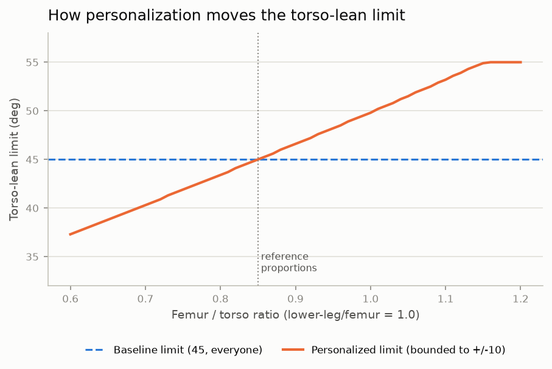

# Personalization: how body proportions change the evaluation

## What the user enters and what we compute

| Ratio | Formula | What it tells us |
|---|---|---|
| R1 | femur / torso | longer thighs relative to the torso |
| R2 | lower leg / femur | longer shins relative to the thighs |
| (check only) | arm / torso | used only to sanity-check measurements against the video |

## The idea in one picture

At the bottom of a squat, the body has to stay balanced over the feet. Imagine the
thigh is horizontal. The longer the thigh, the further back the hips sit, so the
torso has to tip further forward to bring the shoulders back over the feet. Longer
shins let the knees travel further forward, which moves the hips forward and reduces
the lean needed.

```
 side view at parallel (ankle at x = 0)

        shoulder ●            torso leans by angle T
                  \
                   \  torso (length 1)
        hip ●───────\──────● knee        thigh horizontal (length R1)
                            \
                             \  shin (length R1·R2), leans by angle S
                              ● ankle
```

Balance assumption: the shoulder stays over the ankle (x = 0):

```
knee_x     =  R1·R2·sin(S)
hip_x      =  knee_x − R1
shoulder_x =  hip_x + sin(T) = 0
=>  sin(T) = R1 · (1 − R2·sin(S))
```

Code: `predicted_torso_lean_deg()` in `ratemyform/personalization.py`.

## How it is used (bounded and relative)

1. Compute the predicted lean T for the **user's** ratios and for a **reference**
   body (R1 = 0.85, R2 = 1.00), both with the same shin angle S = 30 deg.
2. `adjustment = T_user − T_reference`, **clamped to ±10 deg**.
3. Personalized torso-lean limit = baseline limit (45 deg) + adjustment.

Using only the *difference* means a systematic error in the simple model mostly
cancels out. The clamp means a typo in one measurement can move the limit by at most
10 deg.

| Example body | R1 | R2 | T_user | Adjustment | Limit |
|---|---|---|---|---|---|
| Reference proportions | 0.85 | 1.00 | 25.2 | 0 | 45 |
| Long femur (torso 48, femur 50, shin 42 cm) | 1.04 | 0.84 | 37.2 | +12.0 → **+10** (capped) | 55 |
| Short femur (torso 55, femur 38, shin 42 cm) | 0.69 | 1.11 | 18.0 | −7.1 | 37.9 |

(The values come from the app's Personalization tab and `results/synthetic_evaluation.csv`.)



## What is and is not personalized

| Rule | Personalized? | Why |
|---|---|---|
| Torso lean at the bottom | **Yes** | Directly follows from the balance geometry above |
| Depth target (knee angle ≤ 100 deg) | No | We have no documented way to adjust depth from ratios yet |
| Chest drop while standing up | No | It describes a movement *change*, not a body-shape effect |

## Distinguishing this from validated guidelines

- **Supported by literature (verified citations):** when the knees are kept from
  traveling forward, load shifts from the knee toward the hip. A. C. Fry, J. C. Smith,
  and B. K. Schilling, "Effect of knee position on hip and knee torques during the
  barbell squat," *J. Strength Cond. Res.*, vol. 17, no. 4, pp. 629-633, 2003, reported
  knee torque 150.1 → 117.3 N·m and hip torque 28.2 → 302.7 N·m (unrestricted →
  restricted). S. Lorenzetti *et al.*, "Comparison of angles and the corresponding
  moments in knee and hip during restricted and unrestricted squats," ISBS 2009
  (five subjects), found the same direction with a much smaller hip increase (about
  14-15.5% at a 60° knee angle under load). They state that Fry's tenfold hip-torque
  rise "was not observed," and they describe forward bending of the trunk as a
  compensation during restricted squats. This supports the *direction* of the idea
  (how far the knees and hips can travel affects trunk lean). It does **not** support
  our specific numbers.
- **Prototype assumptions (not validated):** the shoulder-over-ankle balance point,
  thigh exactly horizontal, S = 30 deg, the reference ratios 0.85 / 1.00, the
  baseline limit of 45 deg, and the ±10 deg clamp.
- **To verify:** reference ratios against an anthropometric table. Segment lengths as
  a fraction of height are commonly attributed to R. Drillis and R. Contini, "Body
  segment parameters," Tech. Rep. 1166.03, New York University, 1966, and reproduced
  in D. A. Winter, *Biomechanics and Motor Control of Human Movement*. The exact
  fractions were **not** verified for this prototype.

Nothing here establishes an "ideal" or "safe" squat for anyone. The app says
"reference range" and never "safe/unsafe."

## Measurement sanity check against the video

While the user is standing, `estimate_video_ratios()` measures femur/torso,
lower-leg/femur, and arm/torso from MediaPipe's 3D world landmarks. If an entered
ratio differs by more than 25%, the app warns: "Please double-check this measurement
and that the camera is side-on." Joint centers are not where a tape measure goes, and
3D shoulder-to-hip distance includes the sideways shoulder offset, so small
differences are expected.

## How to demonstrate it

Run the synthetic demos **forward_lean_long_femur** (baseline 9.0 → personalized
10.0) and **forward_lean_short_femur** (9.0 → 7.6). The same 50 deg lean is judged
differently for different bodies, and in both directions. Personalization does not
only make scores higher.
